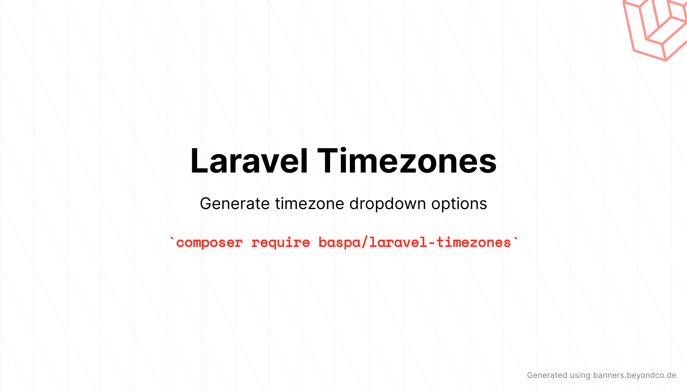

# Laravel package to generate arrays of available timezones to be used in lists.

[](https://packagist.org/packages/baspa/laravel-timezones)
[](https://github.com/baspa/laravel-timezones/actions?query=workflow%3Arun-tests+branch%3Amain)
[](https://codecov.io/gh/baspa/laravel-timezones)
[](https://github.com/baspa/laravel-timezones/actions?query=workflow%3A"Fix+PHP+code+style+issues"+branch%3Amain)
[](https://packagist.org/packages/baspa/laravel-timezones)

The Laravel Timezones package is a convenient solution for Laravel developers who need to include a dropdown menu of timezones in their applications. This package simplifies the process of incorporating a timezone selection feature, saving developers valuable time and effort.

## Installation

You can install the package via composer:

```bash
composer require baspa/laravel-timezones
```

## Usage

### Timezones grouped by continent
```php
use Baspa\Timezones\Facades\Timezones;
// 
$groupedTimezones = Timezones::toArray(grouped: true);
```

### All timezones 
```php
use Baspa\Timezones\Facades\Timezones;
// 
$timezones = Timezones::toArray();
```

### HTML entities or plain text
By default the labels contain HTML entities (non-breaking spaces and plus/minus signs), for output that is not escaped, such as `{!! !!}` in Blade. Pass `htmlencode: false` to get plain text for selects that escape their option labels, such as Filament or Livewire. This works for `toArray()` (flat and grouped) and `toArrayWithContinents()`.

```php
Timezones::toArray()['Asia/Tokyo'];
// "(GMT/UTC&#160;&#43;&#160;09:00)&#160;Tokyo"

Timezones::toArray(htmlencode: false)['Asia/Tokyo'];
// "(GMT/UTC + 09:00) Tokyo"
```

### Filter continents
Use `excludeContinents` to drop continents, or `onlyContinents` to keep just the ones you list. Both can be chained and work with every output method.

```php
use Baspa\Timezones\Facades\Timezones;
// 
$timezones = Timezones::excludeContinents(['Africa', 'America'])
    ->toArray();

$timezones = Timezones::onlyContinents(['Europe', 'Asia'])
    ->toArray(grouped: true);

// Europe only
$timezones = Timezones::onlyContinents(['Europe', 'Asia'])
    ->excludeContinents(['Asia'])
    ->toArray();
```

A second `onlyContinents` call replaces the first, while `excludeContinents` calls add up. The order of the calls doesn't matter.

Continent names are case-insensitive (`'europe'` and `'EUROPE'` both match `Europe`). The output keeps the original continent order, whatever order you pass the names in. An unknown name, a value that isn't a string, or an empty `onlyContinents([])` throws an `InvalidArgumentException`. The valid names are `Africa`, `America`, `Antarctica`, `Arctic`, `Asia`, `Atlantic`, `Australia`, `Europe`, `Indian` and `Pacific`.

### Show offset
```php
$timezones = Timezones::showOffset()->toArray();
// or
$timezones = Timezones::showOffset(showOffset: false)->toArray();
```

### Sort by offset
By default timezones are sorted alphabetically. Use the `sortByOffset` method to sort them by their current UTC offset (UTC-11 first, UTC+14 last) instead. Timezones with the same offset are sorted by identifier.

```php
$timezones = Timezones::sortByOffset()->toArray();
// Keys: Pacific/Midway, Pacific/Niue, Pacific/Pago_Pago (UTC-11), ..., Pacific/Kiritimati (UTC+14)
```

This also works for `toArrayWithContinents()` and for `toArray(grouped: true)`, where each continent is sorted on its own and the order of the continents stays the same. General timezones (UTC and GMT) are sorted as UTC+00:00.

### Offset prefix
The offset starts with `GMT/UTC` by default. Use the `offsetPrefix` method to change it, pass an empty string to leave it out, or call it without an argument to go back to the default. In HTML mode the prefix is escaped with `htmlspecialchars`.

```php
Timezones::offsetPrefix('UTC')->toArray(htmlencode: false)['Asia/Tokyo'];
// "(UTC + 09:00) Tokyo"

Timezones::offsetPrefix('')->toArray(htmlencode: false)['Asia/Tokyo'];
// "(+ 09:00) Tokyo"
```

### Include general timezones
To include general timezones like GMT or UTC use the `includeGeneral` method.

```php
$timezones = Timezones::includeGeneral()->toArray();
```

### Show country names
To include country names alongside timezone labels use the `showCountry` method. With the [intl extension](https://www.php.net/manual/en/book.intl.php) installed, country names are short and in your app's locale (`app()->getLocale()`). Without intl, the package falls back to the official English names from [league/iso3166](https://github.com/thephpleague/iso3166), such as "United Kingdom of Great Britain and Northern Ireland".

```php
// Basic usage with country names
$timezones = Timezones::showCountry()->showOffset(false)->toArray();
// Output: "London (United Kingdom)"

// In a specific locale instead of the app locale
$timezones = Timezones::showCountry(locale: 'nl')->showOffset(false)->toArray();
// Output: "London (Verenigd Koninkrijk)"

// With full continent names preserved
$timezones = Timezones::showCountry()->showOffset(false)->toArrayWithContinents();
// Output: "Europe / London (United Kingdom)"

// Grouped by continent with country names
$timezones = Timezones::showCountry()->toArray(grouped: true);
```

Country names are HTML-escaped in the default HTML output (`Bosnia &amp; Herzegovina`) and left as-is with `htmlencode: false`.

### Validation
The keys of `toArray()` and `toArrayWithContinents()`, and the keys inside each group of `toArray(grouped: true)`, are timezone identifiers (e.g. `Europe/Amsterdam`). You can validate a submitted value with Laravel's `timezone` rule:

```php
$request->validate([
    'timezone' => ['required', 'timezone'],
]);
```

`includeGeneral()` adds `GMT`, which the default `timezone` rule rejects. When you include general timezones, use `timezone:all_with_bc` instead (it also accepts other backward-compatible identifiers, such as `US/Eastern`):

```php
$request->validate([
    'timezone' => ['required', 'timezone:all_with_bc'],
]);
```

## Testing

```bash
composer test
```

## Changelog

Please see [CHANGELOG](CHANGELOG.md) for more information on what has changed recently.

## Contributing

Issues and pull requests are welcome on [GitHub](https://github.com/Baspa/laravel-timezones).

## Credits

- [Baspa](https://github.com/Baspa)
- [All Contributors](../../contributors)

## License

The MIT License (MIT). Please see [License File](LICENSE.md) for more information.
